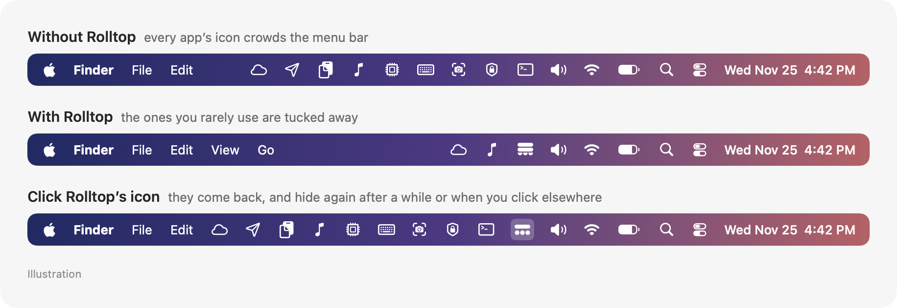
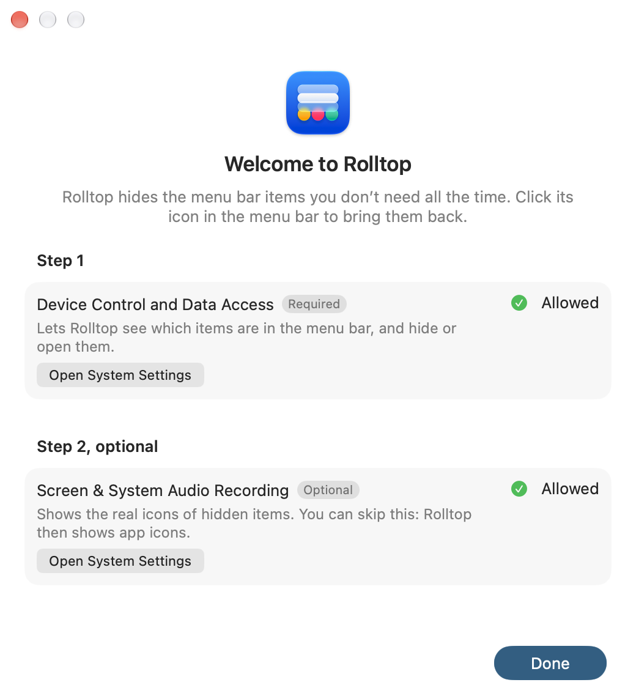
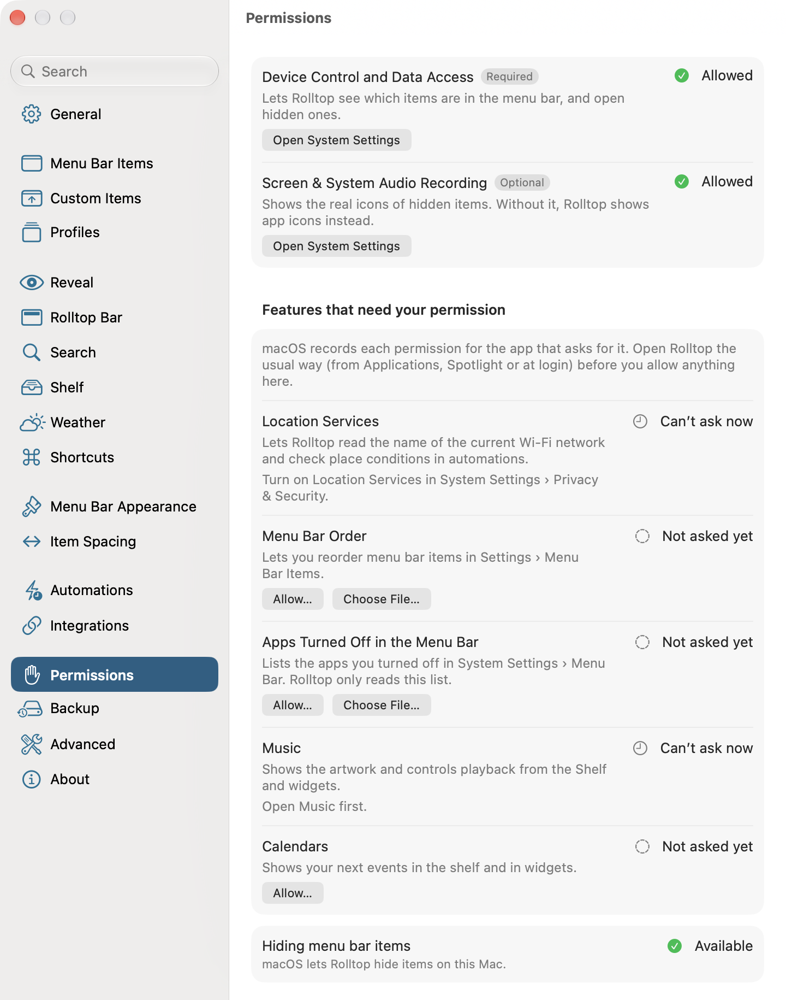
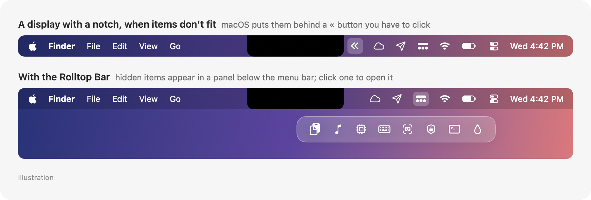
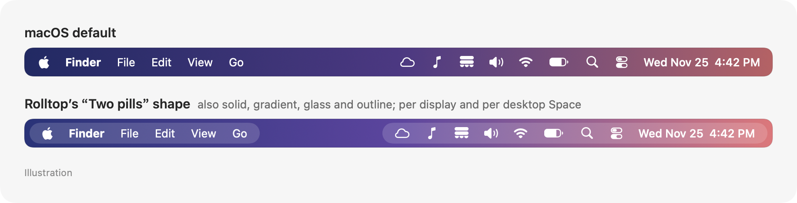
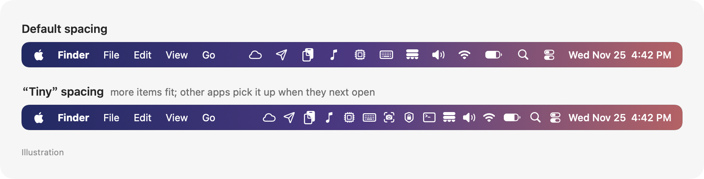

# Rolltop

[简体中文](README.md) · **English**

Rolltop is a menu bar manager for macOS 27: it tucks away the menu bar icons you rarely use and brings them back with a click. Free and open source, with no account, no analytics and no automatic updates.

**[Download Rolltop.dmg](https://github.com/hyttgmail/Rolltop/releases/latest/download/Rolltop.dmg)**: macOS 27, Apple silicon.



> **Just want to hide some icons? You need to grant one permission: Device Control and Data Access.**
> Every other permission is optional and is never requested up front. Grant one only when you use the feature that needs it; hiding icons works without any of them.

- [Install](#install)
- [Permissions: one required, the rest are up to you](#permissions-one-required-the-rest-are-up-to-you)
- [Features](#features)
- [What macOS 27 does not allow](#what-macos-27-does-not-allow)
- [Data, backup, reset and uninstall](#data-backup-reset-and-uninstall)
- [Feedback and contributing](#feedback-and-contributing)
- [License](#license)

Rolltop offers what Bartender does, but it has nothing to do with Bartender or its developer: the name, icon and interface are original. A few parts are adapted from Hidden Bar (MIT License; see [THIRD_PARTY_NOTICES.md](THIRD_PARTY_NOTICES.md), also shown in Settings › About).

The app's interface is in English and Simplified Chinese and follows your system language.

## Install

Requires **macOS 27** and **Apple silicon**.

1. Download [Rolltop.dmg](https://github.com/hyttgmail/Rolltop/releases/latest/download/Rolltop.dmg) (free, signed and notarized by Apple).
2. Open the DMG, drag Rolltop to Applications, then open it from Applications. The first time, macOS asks you to confirm an app downloaded from the internet: click Open.
3. In the welcome window, allow Device Control and Data Access (Step 1). That's it. Step 2 is optional.

- **Rolltop must run from Applications** (`/Applications`). macOS 27 hides the menu bar items of apps that run from anywhere else, Rolltop's own included.
- **Updates**: there is no automatic update. Download the new DMG and replace the copy in Applications; your settings and the permissions you granted are kept. All versions are under [Releases](https://github.com/hyttgmail/Rolltop/releases).
- Rolltop has no Dock icon. Opening Rolltop again from the Finder or Spotlight opens its settings; you can also right-click Rolltop's icon in the menu bar and choose Settings….

### Build from source

You need Xcode 27.2 or later and [XcodeGen](https://github.com/yonaskolb/XcodeGen) (`brew install xcodegen`).

```bash
git clone https://github.com/hyttgmail/Rolltop.git
cd Rolltop
scripts/dev-install.sh --release --open
```

The script builds Rolltop, installs it as `/Applications/Rolltop.app` and opens it. It replaces a downloaded copy if you have one, and you will need to grant the permissions again because the signature differs.

- **Signing**: builds are signed ad hoc by default, which needs no certificate. The catch: after every rebuild macOS treats Rolltop as a new app and asks for the permissions again. With an "Apple Development" certificate, put its SHA-1 (`security find-identity -v -p codesigning` lists it) in a `.signing-identity` file at the repository root (not in git), or set `ROLLTOP_SIGN_IDENTITY`; the permissions then survive rebuilds.
- **Release builds** (for maintainers): `scripts/package.sh` signs with a Developer ID certificate and the hardened runtime, has Apple notarize the app and the DMG, and writes `.build/package/Rolltop.dmg`. Save notary credentials once with `xcrun notarytool store-credentials` and name them in `ROLLTOP_NOTARY_PROFILE`.

## Permissions: one required, the rest are up to you

The welcome window on first launch: Step 1 is the only required permission, Step 2 can be skipped.

<p align="center"></p>

### Which ones do I need?

| What you want | Permission | |
|---|---|---|
| **Hide and show menu bar icons**, including shortcuts, showing on hover or click, hiding again automatically, the Rolltop Bar, Search, groups, spacers, profiles and menu bar appearance | **Device Control and Data Access** | **Required** |
| See what hidden icons really look like in the Rolltop Bar and Search (app icons otherwise) | Screen & System Audio Recording | Optional |
| Start Rolltop when you log in | Login Items | Optional |
| Reorder icons by dragging them in Settings (⌘-dragging in the menu bar works without it) | Access to another app's data: Menu Bar Order | Optional |
| See which apps you turned off in System Settings › Menu Bar | Access to another app's data: Apps Turned Off in the Menu Bar | Optional |
| Switch automatically by Wi-Fi network name or place | Location Services | Optional |
| Show your next events in the Shelf or a widget | Calendars | Optional |
| Show and control Music or Spotify in the Shelf or a widget | Automation | Optional |
| Clipboard history | Paste from Other Apps | Optional |

Three rules hold for every optional permission:

- **Never asked up front.** An optional permission is requested only after you turn on its feature or click Allow…. One exception: once you turn on clipboard history, macOS itself may ask when Rolltop reads the clipboard.
- **Saying no costs nothing else.** Only that feature stops working.
- **You can take it back at any time.** Turn Rolltop off in the matching page of System Settings › Privacy & Security; turn off login in Settings › General. File access you gave with Choose File… is not listed in System Settings, and resetting Rolltop does not clear it: quit Rolltop and run `defaults delete com.alphapengwang.rolltop rolltop.layout-editor.bookmark-layout` (for the other file, end the key with `bookmark-allow-list`).

Settings › Permissions shows the state of most of them. Open Rolltop from Applications or Spotlight before you allow anything: when it is started from a terminal, macOS records permissions for the terminal instead, so Rolltop greys out its Allow… buttons.

<p align="center"></p>

### Required: Device Control and Data Access

Called Accessibility in earlier versions of macOS. It is in **System Settings › Privacy & Security › Device Control and Data Access**; searching System Settings for "Accessibility" finds the unrelated top-level Accessibility pane (VoiceOver and so on) instead.

**Why it is required**: it is how Rolltop learns which icons are in the menu bar. Without it Rolltop sees no icons, so it hides nothing.

**The permission itself is broad**: an app that has it could read other apps' interfaces and simulate the keyboard and mouse. This is all Rolltop does with it:

| What | When |
|---|---|
| Reads each app's menu bar icons (name, identifier, position and size) and where the current app's menu titles are | While it runs |
| Clicks an icon and watches for its menu to close | When you open a hidden icon from the Rolltop Bar, Search, a group, a shortcut, Shortcuts, AppleScript or a link |
| Replays your click on the clock once | When you click the clock while icons are hidden (macOS ignores the clock then; without the replay, Notification Center would not open) |
| Watches mouse clicks, movement and scrolling | To tell whether you clicked an empty part of the menu bar, hovered over it or clicked elsewhere |
| Watches the keyboard for the Escape key only | Only while the Rolltop Bar or the Shelf is open, to close it; other keys are ignored, never recorded |
| Simulates ⌘V once | Only when you choose to paste a clipboard history entry straight into the app in front |

Rolltop does not read text in windows, documents, web pages or text fields. Global shortcuts use the system hot key API, not keyboard monitoring. The code is mostly in [`Rolltop/Platform/AX`](Rolltop/Platform/AX) and [`Rolltop/Platform/EventSynthesizer.swift`](Rolltop/Platform/EventSynthesizer.swift).

### Optional permissions, one by one

**Screen & System Audio Recording** (System Settings › Privacy & Security)

- What for: captures the menu bar strip and cuts out each icon's real image for the Rolltop Bar and Search. When the Rolltop Bar opens, it also measures how bright the screen behind it is, to choose a light or dark panel.
- Data: only the small icon images are kept, in a cache folder on this Mac ([where](#data-backup-reset-and-uninstall)); the brightness sample is discarded at once. Nothing is recorded as video or audio, and nothing is uploaded.
- Without it: app icons are shown, and the Rolltop Bar follows the system appearance.
- With it, you can still turn off Show real item images, or clear the saved images, in Settings › Rolltop Bar › Item images.

**Login Items** (System Settings › General › Login Items & Extensions)

- What for: starts Rolltop when you log in. macOS registers it once you turn on Open at login in Settings › General, and may show a notification.
- Without it: after a restart every icon is shown until you open Rolltop yourself.

**Menu Bar Order** (a row in Settings › Permissions; macOS calls it access to data from other apps)

- What for: reordering icons by dragging them in Settings › Menu Bar Items.
- Data: reads **and writes** the system's menu bar layout file, `com.apple.MenuBar.plist`, changing only the positions of the icons you drag. Rolltop checks the result and restores the old value if it did not take effect.
- If no dialog appears, or you said no, you can click Choose File… and pick the file yourself.
- Without it: hold ⌘ and drag icons in the menu bar; the result is the same.

**Apps Turned Off in the Menu Bar** (the next row)

- What for: lists the apps you turned off in System Settings › Menu Bar, for when you wonder where an icon went.
- Data: **only reads** Control Center's `group.com.apple.controlcenter.plist`; never changes it.
- Without it: you don't see that list.

**Location Services** (System Settings › Privacy & Security › Location Services)

- What for: two things, both in automations: reading the name of the current Wi-Fi network (macOS treats it as location data), and "at a place / away from a place" conditions.
- Data: compared on this Mac only, never uploaded. The coordinates of places you save are stored in Rolltop's settings and included in backups, so mind that before you share a backup.
- Without it: those two kinds of condition never hold. "Connected to Wi-Fi" works without it.
- Weather does **not** use your location: you search for the place yourself.

**Calendars** (System Settings › Privacy & Security › Calendars)

- What for: Up next in the Shelf and the calendar widget. Reads each event's title, time and calendar, and looks for a meeting link in its URL, location and notes.
- Reading events requires full access, the only level macOS offers for that; Rolltop only reads and never creates or changes events. Events are not uploaded.
- Without it: that section stays empty.

**Automation: Music, Spotify** (System Settings › Privacy & Security › Automation)

- What for: track and artwork, play/pause, previous and next. Each player asks once; a player that isn't installed never appears.
- Without it: no artwork and no controls; the title the player broadcasts itself may still show.
- If a script you write controls another app, macOS asks about that too, on Rolltop's behalf, and you decide.

**Paste from Other Apps** (System Settings › Privacy & Security)

- What for: clipboard history in the Shelf, **off by default**.
- Data: records the text, rich text, links, file references and images you copy, on this Mac only, up to 100 entries for 7 days by default; turning the feature off deletes the history. Anything marked concealed or temporary (password managers usually mark what they copy) is never read, and 1Password, Bitwarden, Passwords and similar apps are ignored by default.
- Entries are stored as ordinary files that only your account can read; they are not encrypted further.
- Without it: nothing is recorded; the rest of the Shelf is unaffected.

### No dialog, but you should know

- **Network**: only two places. Weather (off by default) sends Open-Meteo the coordinates of the place you chose, rounded to two decimals (about 1 km), and the city names you search for. Spotify artwork is downloaded only after you allow Rolltop to control Spotify. Rolltop makes no other network requests.
- **Scripts**: script conditions in automations and script widgets run your command with `/bin/sh`, with your account's rights. Each one must be approved on this Mac first; scripts imported from a backup arrive turned off.
- **Links**: other apps can show or hide icons with `rolltop://` links. An app is asked about the first time it sends one; senders that can't be identified (such as `open` in a terminal) are allowed by default, which you can turn off in Settings › Integrations. Links that change settings are refused by default, and no link can delete, reset, import, export or run scripts.
- **File shelf**: the Shelf remembers where files are and never copies them. For files in Desktop, Documents or Downloads, macOS may ask whether Rolltop may access that folder.
- **Not sandboxed**: macOS does not let sandboxed apps use Device Control and Data Access, so Rolltop is not sandboxed.
- **Private APIs**: hiding icons uses the private MenuBarClientCore framework; reading desktop Spaces and display brightness also uses private APIs (read only). A macOS update may break them; Rolltop then hides nothing.
- **Item spacing** writes the system keys `NSStatusItemSpacing` and `NSStatusItemSelectionPadding`; setting it back to Default removes them.

### Never requested

Nothing in the code asks for: Full Disk Access, microphone, camera, contacts, photos, Bluetooth, notifications or an administrator password. If one of these appears on Rolltop's behalf, it comes from a script you wrote, or it is a bug: please [report it](#feedback-and-contributing).

## Features

### At a glance

**MacBooks with a notch**: with many icons, the space to the right of the notch runs out. macOS puts the extra ones behind a « button; turn on Use the Rolltop Bar when the menu bar is full (Settings › Rolltop Bar) and Rolltop lists hidden icons in a panel below the menu bar instead.



**Menu bar appearance**: restyle the menu bar. Off by default.



**Item spacing**: less space between icons, so more of them fit.



The menu bar pictures are illustrations, with generic symbols standing in for other apps' icons; the welcome window and the Permissions pane are real screenshots.

### All features

Grouped as in [docs/PLAN.md](docs/PLAN.md) §2 (in Chinese). Names in parentheses are the settings panes.

| Area | Status |
|---|---|
| Sections | Done. Shown, Hidden and Always Hidden, assigned per app; you choose the section for new icons (General). Drag icons between sections in Menu Bar Items. |
| Showing hidden icons | Done. Click Rolltop's icon to show or hide them; Option-click also shows always-hidden ones; right-click or Control-click opens its menu. Also: clicking an empty part of the menu bar (on by default), hover (off by default, adjustable delay), scrolling (off by default) and shortcuts (Reveal, Shortcuts). |
| Hiding again | Done. After a delay (10 s by default), when you click elsewhere (on by default) or switch apps (off by default); paused while the pointer is in the menu bar or a menu is open (Reveal). |
| Making room | Done, off by default. While hidden icons are shown, shown icons step aside, optionally only on displays with a notch; icons in "Keep visible when hiding everything" stay (the clock and Control Center by default) (Reveal, General). |
| Rolltop Bar | Done, off by default. A glass panel below the menu bar listing hidden icons; click one to show and open it. Five styles; can be limited to displays with a notch, or used whenever the menu bar is full (Rolltop Bar). |
| Icon images | Done. With Screen & System Audio Recording, real icon images are captured and cached (a section of the Rolltop Bar pane). |
| Search | Done. Fuzzy search across menu bar items, profiles and commands; Shift- or Control-Return right-clicks (Search). No default shortcut: assign one in Shortcuts. |
| Automations | Done. Conditions: power and battery, Wi-Fi and network name, an app running or in front, time of day, display setup, place, scripts (each approved on this Mac), combined with "all" or "any". Actions: show items, apply a profile, run a command (Automations). An "icon changed" condition exists only in the data model, with no interface and no data source. |
| Profiles | Done. Applied at launch, by display setup or by Focus (Focus Filter "Use Rolltop Profile"); shortcuts for the first five profiles and next/previous (Profiles). |
| Spacing | Done. Default, Small, Tiny, None or custom values; writes the system's `NSStatusItemSpacing` and `NSStatusItemSelectionPadding`, which other apps pick up after they relaunch or you log in again (Item Spacing). |
| Menu bar appearance | Done, off by default. Solid, gradient, material, glass or outline; full width, rounded bar or two pills; corner radius, border, shadow; per display and per desktop Space; rounded screen corners and rounded corners below the menu bar (Menu Bar Appearance). |
| Shortcuts | Done. Global actions, "show and click / right-click" per icon, profiles, and Hide Everything (Shortcuts). |
| Layout editor | Done. Drag icons between sections; items macOS restricts are marked. With Menu Bar Order allowed you can reorder them; with the other file allowed it lists apps turned off in System Settings (Menu Bar Items). |
| Spacers | Done. Custom width; empty, text, emoji or an SF Symbol (Custom Items). |
| Groups | Done. One icon that holds several hidden ones and opens a small panel on click or hover (Custom Items). |
| Widgets | Done. CPU, GPU, memory, network, battery, disk, clock and date, text, script output, music, next calendar event, Focus, weather; a click can open an app, run a command or show a menu (Custom Items). These items belong to Rolltop and can't be hidden. |
| Automation interfaces | Done: links (URL scheme), Shortcuts (App Intents) and AppleScript; see below (Integrations). |
| General | Partly done. Open at login, onboarding, settings export / import / automatic backups / reset (General, Backup, Advanced), the style of Rolltop's own icon (General › Menu bar icon, 6 choices), and you can hide Rolltop's own icon. |
| Shelf (like Top Shelf) | Done. A glass panel at the top center of the screen, below the notch: clipboard history (can paste straight into the app in front), a file shelf, and your next events; these three are off by default. Now Playing and Weather cards appear when they have something to show; brief notices for volume, brightness and battery changes can be turned off. Opens from "Shelf" in Rolltop's menu, a shortcut, hover, or dragging a file to the top of the screen (Shelf). |

## What macOS 27 does not allow

These are system limits, not Rolltop bugs; every app of this kind has them:

- **Hiding works per app.** An app's icons show or hide together; you can't hide just one of them. Among system icons, only Battery, Bluetooth, Clock, Sound, Wi-Fi and Control Center can be controlled one by one.
- **As soon as anything is hidden, macOS also hides AirDrop, Focus, Now Playing and similar system icons**, and nothing can keep them. That's why Rolltop holds no restriction at all while nothing needs hiding.
- **Reordering icons means reading and writing the system's layout file**, so reordering in Rolltop needs your separate permission (see [Permissions](#optional-permissions-one-by-one)). ⌘-dragging in the menu bar needs no permission.
- Icons that don't fit go behind macOS's own overflow button, and no public API controls that.

## Automation

**Links (`rolltop://`)**: the general form is `rolltop://command/<command id>?argument=value`, with shorthands `rolltop://show`, `rolltop://hide`, `rolltop://toggle`, `rolltop://show-all`, `rolltop://profile/<id>`, `rolltop://item/<owner>?button=right`, `rolltop://search` and `rolltop://settings/<pane id>`.

```bash
open "rolltop://command/visibility.show-hidden"
```

```bash
open "rolltop://item/system:wifi?button=right"
```

- Settings › Integrations controls who may send links: "Allow links" (on by default), "Allow links from unknown senders" (`open` in a terminal is one; on by default) and "Allow links that change settings" (off by default; needed for commands that change the layout, styles and so on). No link can delete, reset, import, export or run scripts. Rolltop asks once the first time an app sends a link.
- Debug builds are an exception: links from senders without an identity, such as a terminal, skip these rules; the test script `scripts/rolltop-cmd.sh` relies on that.
- The Integrations pane lists link examples you can copy.

**Shortcuts**: the actions are Show Hidden Items, Hide Hidden Items, Toggle Hidden Items, Show All Items, Apply Profile, Get Current Profile, Open Menu Bar Item, Set Section of Menu Bar Item, Get Menu Bar Items and Run Rolltop Command, plus the Focus Filter "Use Rolltop Profile".

**AppleScript** (dictionary in `Rolltop/Features/Automation/Rolltop.sdef`): the commands `show hidden items`, `hide hidden items`, `toggle hidden items`, `apply profile`, `open menu bar item` (optionally `right click`) and `run command` (optionally `with arguments`); readable properties `profiles`, `menu bar items`, `current profile` and `hidden items showing`.

```bash
osascript -e 'tell application "Rolltop" to toggle hidden items'
```

```bash
osascript -e 'tell application "Rolltop" to open menu bar item "system:wifi"'
```

The first time a terminal or another app controls Rolltop with AppleScript, macOS asks whether to allow that app to control Rolltop.

## Data, backup, reset and uninstall

| What | Where |
|---|---|
| Settings and layout | Preferences domain `com.alphapengwang.rolltop`, keys starting with `rolltop.` (`defaults read com.alphapengwang.rolltop`) |
| Profiles | `~/Library/Application Support/Rolltop/Profiles/` |
| Automatic backups (the last 10, `.rolltopbackup`) | `~/Library/Application Support/Rolltop/Backups/` |
| Script condition approvals | `~/Library/Application Support/Rolltop/Automations/script-approvals.json` |
| Shelf clipboard history and file shelf | `~/Library/Application Support/Rolltop/Shelf/` |
| Debug output (Debug builds only) | `~/Library/Application Support/Rolltop/debug/` |
| Icon image cache | `~/Library/Caches/com.alphapengwang.rolltop/items/` |

- **Backup**: Settings › Backup › Export… writes a `.rolltopbackup` file (JSON with settings, layout and each feature's data, without link permissions or script approvals); Import… shows a preview, then lets you choose what to import.
- **Reset**: on the Backup pane, Reset Layout… resets only the sections, and Reset Everything… makes a backup first, then clears settings, profiles and automations. Reset… on the Advanced pane (Reset all settings) clears settings and layout **without a backup**.
- **Uninstall**:
  1. Turn off Open at login on the General pane, then choose Quit Rolltop from Rolltop's menu.
  2. If you changed the spacing on the Item Spacing pane, set it back to Default first (those two system keys are outside Rolltop's preferences domain).
  3. Delete `/Applications/Rolltop.app` and the folders in the table above, and run `defaults delete com.alphapengwang.rolltop`.
  4. Remove Rolltop from System Settings › Privacy & Security › Device Control and Data Access and from every other page where you allowed it (Screen & System Audio Recording, Location Services, Calendars, Automation and so on).
- **Test apps**: `/Applications/RolltopFixture.app` and `/Applications/RolltopFixtureB.app` are status item apps that `scripts/fixture.sh` installs for live tests. You can delete them (run `scripts/fixture.sh stop all` first).

## How it works

On macOS 27 the whole menu bar is drawn by the system process MenuBarAgent; individual icons have no windows of their own, so the old "oversized divider" trick no longer works. Rolltop reads each app's menu bar items and where they are actually drawn through the Accessibility API, then uses an allow-list assertion from the private MenuBarClientCore framework to tell macOS which apps and system modules may show; macOS hides the rest and reflows the bar. The assertion ends with Rolltop's process, so the menu bar recovers at once if Rolltop quits or crashes. To open a hidden icon, Rolltop allows it for a moment, waits until it is drawn, clicks it, and restores the restriction when its menu closes. The private API is resolved at run time; when it is unavailable, Rolltop hides nothing. Details and measurements: [docs/PLATFORM.md](docs/PLATFORM.md).

## Known limitations and what is unverified

- Most live testing during development ran with Rolltop started from a terminal, inheriting the terminal's permissions; the main features were confirmed by the author with a normal launch on one Mac.
- Tested on one Mac only (macOS 27.2.1, a notched built-in display plus an external display). Ad hoc signed builds were not tested for permissions on a real launch.
- The downloadable build (Developer ID, hardened runtime) was tested only when started from a terminal: hiding works and menu bar icons are read. Its permission flow on a normal launch, and its Location and Calendars dialogs, were not tested.
- On first launch with English as the system language, the welcome window is too short for its text: the button of Step 2 is partly hidden behind the window's bottom bar. Allow Screen & System Audio Recording from Settings › Permissions instead.
- Now Playing with Music is confirmed; Spotify was never tested on a real machine. Arriving at and leaving a place were not tested.
- Whether each optional permission shows its dialog on a normal launch was not checked one by one; the Menu Bar Order row was completed with Choose File….
- System module ids 3, 4 and 7 (Displays, Keyboard, Screen Mirroring) are guesses that could not be checked on this Mac; the layout editor marks them.
- The links that open System Settings use the macOS 14/15 form: the Device Control and Data Access one opens the right page on 27.2.1 (window title Device Control and Data Access, checked by the author); the Screen & System Audio Recording one is unverified on 27.
- Menu bar styles don't change the menu bar's text color; behavior in full-screen Spaces and with a light menu bar over a bright wallpaper is unverified.
- The 6 styles of Rolltop's own icon are template images, seen only on a dark menu bar; a light menu bar is unverified.
- The AppleScript and Shortcuts examples above were written from the dictionary and the code and never run (running them raises a system dialog); the `command` form of links was run in Debug builds, and the shorthands were only checked against the code.

## Project layout and tests

```
project.yml              XcodeGen project (Rolltop.xcodeproj is generated from it, not in git)
Rolltop/App/             entry point, composition root, command registry, status item
Rolltop/Engine/          visibility engine, item catalog, settings store
Rolltop/Platform/        the only way to macOS 27 mechanisms (private API included)
Rolltop/Features/<Name>/ one directory per feature; features never reference each other
Rolltop/UI/              shared interface components
Rolltop/Resources/       Info.plist, AppIcon.icon (Icon Composer), Assets.xcassets
Packages/RolltopCore/    pure Swift package: model and decision logic
RolltopTests/            app tests (Core plus one directory per feature)
scripts/                 install, live-test lock, test apps, command sender, menu bar probe, name check
scripts/icon/            scripts that generate the app icon and the menu bar glyphs
docs/                    plan, platform facts, design rules, developer contracts
```

```bash
xcodegen generate
xcodebuild -project Rolltop.xcodeproj -scheme Rolltop -configuration Debug -derivedDataPath .build/dd build
swift test --package-path Packages/RolltopCore
xcodebuild -project Rolltop.xcodeproj -scheme Rolltop -destination 'platform=macOS,arch=arm64' -derivedDataPath .build/dd test
python3 -I scripts/check-names.py
```

- The app icon is generated by `swift scripts/icon/make-icon.swift` (writing `Rolltop/Resources/AppIcon.icon` and the menu bar glyphs); `scripts/icon/render.sh` renders it the way macOS does, in every appearance and size, with Xcode's `ictool`.
- Live tests use the one and only menu bar: take `scripts/live-lock.sh acquire <name>` first, drive Rolltop with `scripts/rolltop-cmd.sh <command id> [key=value…]`, then quit Rolltop and `scripts/live-lock.sh release`. The full procedure and safety rules are in `CLAUDE.md` and [docs/CONTRACTS.md](docs/CONTRACTS.md).

## Feedback and contributing

- Questions or ideas: open an [issue](https://github.com/hyttgmail/Rolltop/issues).
- Want to change code: fork the repository and open a [pull request](https://github.com/hyttgmail/Rolltop/pulls). Anyone can; a pull request is a suggestion.
- **Only the author can write to this repository.** There are no other collaborators: whether and when a pull request is merged is the author's call, and the author may also take the idea and implement it differently.
- Submit only code you wrote. Don't copy source from Thaw or other menu bar managers; if you drew on another open-source project, name it and its license in the pull request.
- Before you start, read [docs/PLATFORM.md](docs/PLATFORM.md) (measured macOS 27 facts), [docs/CONTRACTS.md](docs/CONTRACTS.md) (developer contracts) and [docs/DESIGN.md](docs/DESIGN.md) (interface rules). Open an issue before adding any new permission.

## License

Copyright (C) 2026 Peng Wang

Rolltop is released under the [GNU General Public License version 3](LICENSE) (SPDX: `GPL-3.0-only`): you may use, change and share it; if you distribute a modified version or a built app, you must provide its source under the same license. There is no warranty.

The parts adapted from Hidden Bar were originally MIT-licensed; their notice is kept in [THIRD_PARTY_NOTICES.md](THIRD_PARTY_NOTICES.md).
