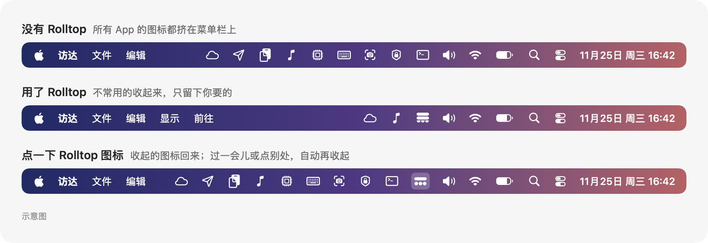
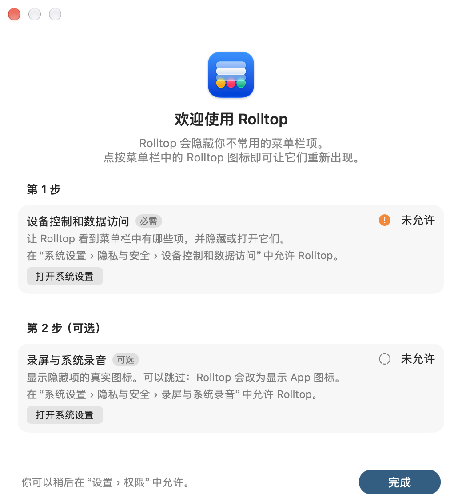
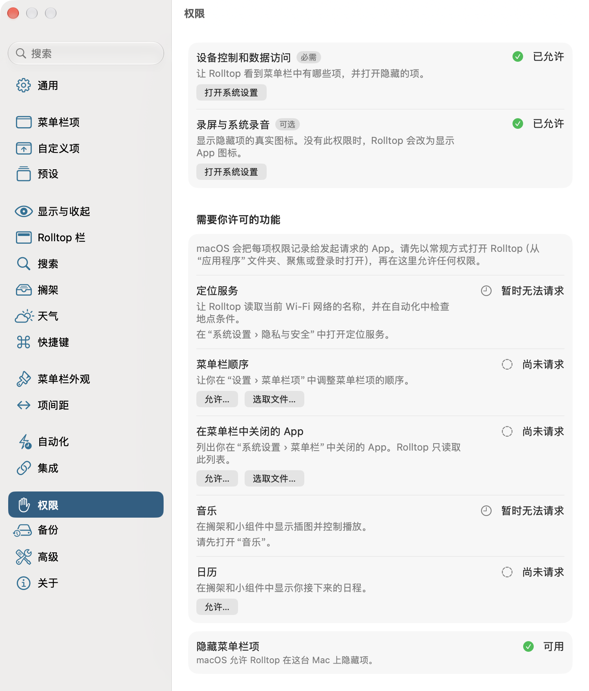
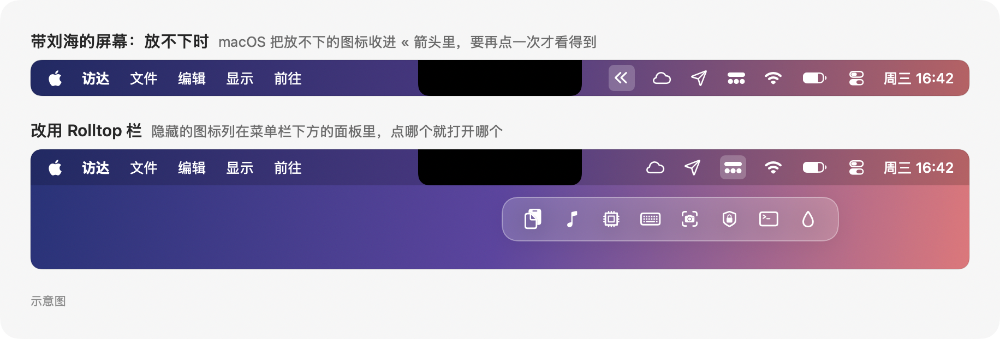
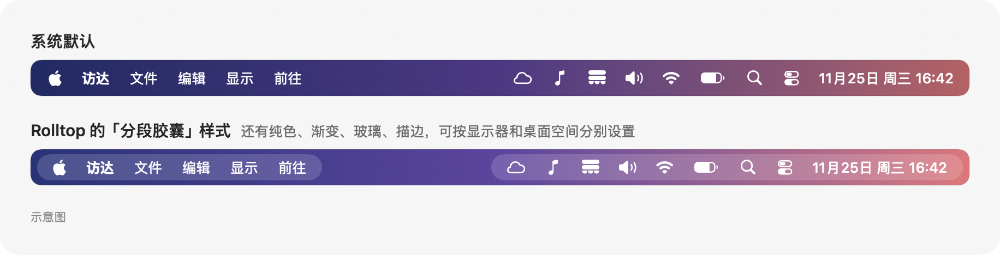

# Rolltop

Rolltop 是一个 macOS 27 的菜单栏管理器：把不常用的菜单栏图标收起来，需要时点一下再显示。免费、开源，没有账号、统计和自动更新。

**[下载 Rolltop.dmg](https://github.com/hyttgmail/Rolltop/releases/latest/download/Rolltop.dmg)**，macOS 27，Apple 芯片。



> **只想隐藏多余的图标？只需要给一项权限：「设备控制和数据访问」。**
> 其他权限全部可选，默认都不请求。用到对应功能时再给；不给也不影响隐藏图标。

- [安装](#安装)
- [权限：一项必需，其余自选](#权限一项必需其余自选)
- [功能](#功能)
- [macOS 27 不允许的事](#macos-27-不允许的事)
- [数据位置、备份、重置与卸载](#数据位置备份重置与卸载)
- [反馈与贡献](#反馈与贡献)
- [许可证](#许可证)

Rolltop 的功能对标 Bartender，但与 Bartender 及其开发者没有任何关系；名称、图标和界面是原创的。代码中有几处改写自 Hidden Bar（MIT 许可证，见 [THIRD_PARTY_NOTICES.md](THIRD_PARTY_NOTICES.md)，设置 › 关于里也能看到）。

## 安装

需要 **macOS 27** 和 **Apple 芯片**。

1. 下载 [Rolltop.dmg](https://github.com/hyttgmail/Rolltop/releases/latest/download/Rolltop.dmg)（免费，已签名并经 Apple 公证）。
2. 打开 DMG，把 Rolltop 拖进「应用程序」，再从「应用程序」打开它。第一次打开时 macOS 会确认“这是从互联网下载的 App”，点「打开」。
3. 按引导窗口的「第 1 步」允许「设备控制和数据访问」，完成。「第 2 步」可以跳过。

- **必须放在「应用程序」**（`/Applications`）里运行。macOS 27 会隐藏从其他位置运行的 App 的菜单栏图标，Rolltop 自己的也一样。
- **更新**：没有自动更新。下载新版 DMG，替换「应用程序」里的旧版即可，设置和已给的权限都会保留。历次版本见 [Releases](https://github.com/hyttgmail/Rolltop/releases)。
- Rolltop 没有 Dock 图标。在 Finder 或「聚焦」里再次打开 Rolltop，会打开设置窗口；也可以右键点菜单栏里的 Rolltop 图标选「设置…」。

### 从源码构建

需要 Xcode 27.2 或更新版本，以及 [XcodeGen](https://github.com/yonaskolb/XcodeGen)（`brew install xcodegen`）。

```bash
git clone https://github.com/hyttgmail/Rolltop.git
cd Rolltop
scripts/dev-install.sh --release --open
```

脚本会构建、装到 `/Applications/Rolltop.app` 并打开。如果之前装过下载版，它会被替换，权限要重新给一次，因为签名不同了。

- **签名**：默认是 ad-hoc 签名，不需要开发者证书；代价是每次重新构建后，macOS 会把它当成新的 App，之前给的权限要重新给。有 “Apple Development” 证书的话，把证书的 SHA-1（`security find-identity -v -p codesigning` 可查）写进仓库根目录的 `.signing-identity` 文件（不入库），或设环境变量 `ROLLTOP_SIGN_IDENTITY`，授权就能跨构建保留。
- **打包发布版**（维护者用）：`scripts/package.sh` 用 Developer ID 证书签名（开启 hardened runtime），交给 Apple 公证，生成 `.build/package/Rolltop.dmg`。需要先用 `xcrun notarytool store-credentials` 存好凭据，并用 `ROLLTOP_NOTARY_PROFILE` 指定它的名字。

## 权限：一项必需，其余自选

第一次打开 Rolltop 时的引导窗口：第 1 步是唯一必需的权限，第 2 步可以跳过。

<p align="center"></p>

### 我该开哪些？

| 你想要的 | 需要的权限 | |
|---|---|---|
| **隐藏和显示菜单栏图标**，包括快捷键、悬停或点击显示、自动收起、Rolltop 栏、搜索、分组、间隔符、预设、菜单栏外观 | **设备控制和数据访问** | **必需** |
| 在 Rolltop 栏和搜索里看到隐藏图标的真实样子（不给就显示 App 图标） | 录屏与系统录音 | 可选 |
| 开机自动启动 | 登录项 | 可选 |
| 在设置里拖动调整图标顺序（不给就用系统自带的 ⌘ 拖动） | 访问其他 App 的数据：菜单栏顺序 | 可选 |
| 查看哪些 App 在系统设置里被关掉了菜单栏图标 | 访问其他 App 的数据：在菜单栏中关闭的 App | 可选 |
| 按 Wi-Fi 名称或地点自动切换 | 定位服务 | 可选 |
| 在搁架或小组件里显示接下来的日程 | 日历 | 可选 |
| 在搁架或小组件里显示并控制“音乐”或 Spotify | 自动化 | 可选 |
| 剪贴板历史 | 从其他 App 粘贴 | 可选 |

三条规则，对所有可选权限都成立：

- **不主动要**。可选权限只在你打开对应功能或点「允许…」之后才会弹框。例外是剪贴板历史：你打开它以后，macOS 自己可能在 Rolltop 读取剪贴板时询问。
- **拒绝没有后果**。只有那一个功能不工作，其余照常。
- **随时能收回**。在 系统设置 › 隐私与安全 的对应页面关掉 Rolltop；登录项在 设置 › 通用 关。用「选取文件…」给过的文件访问不在系统设置里，重置设置也不会清除：先退出 Rolltop，再执行 `defaults delete com.alphapengwang.rolltop rolltop.layout-editor.bookmark-layout`（另一个文件把末尾换成 `bookmark-allow-list`）。

大部分权限的当前状态可以在 Rolltop 的 设置 › 权限 里看到。请从「应用程序」或「聚焦」打开 Rolltop 再授权：从终端直接运行时，macOS 会把授权记在终端名下，所以那时 Rolltop 的「允许…」按钮是灰的。

<p align="center"></p>

### 必需：设备控制和数据访问

英文 *Device Control and Data Access*，以前的系统里叫“辅助功能”（Accessibility）。在 **系统设置 › 隐私与安全 › 设备控制和数据访问**；搜“辅助功能”找不到，顶层的“无障碍”页也不是它。

**为什么必需**：Rolltop 靠它得知菜单栏里有哪些图标。没有它，Rolltop 读不到任何图标，也就不会隐藏任何东西。

**这项权限本身很大**：拿到它的 App 理论上可以读取其他 App 的界面，也可以模拟键盘和鼠标。Rolltop 实际只做这些：

| 做什么 | 什么时候 |
|---|---|
| 读取每个 App 菜单栏图标的名称、标识、位置和大小，以及当前菜单标题占的位置 | 运行期间 |
| 点击某个图标，并观察它的菜单何时关闭 | 你从 Rolltop 栏、搜索、分组、快捷键、快捷指令、AppleScript 或链接里打开它时 |
| 把你在时钟上的点击重放一次 | 有图标被隐藏时你点了时钟（macOS 此时不响应时钟，不重放就打不开通知中心） |
| 监听鼠标点击、移动和滚动 | 用来判断你是否点了菜单栏空白处、悬停在菜单栏上，或点了别处 |
| 监听键盘，只认 Esc 键 | 仅在 Rolltop 栏或搁架打开期间，用来关闭面板；其他按键直接忽略，不记录 |
| 模拟一次 ⌘V | 仅当你在剪贴板历史里选择“直接粘贴”时 |

Rolltop 不读取窗口里的文字、文稿、网页或输入框内容。全局快捷键用的是系统的热键接口，不靠监听键盘。相关代码主要在 [`Rolltop/Platform/AX`](Rolltop/Platform/AX) 和 [`Rolltop/Platform/EventSynthesizer.swift`](Rolltop/Platform/EventSynthesizer.swift)。

### 可选权限，逐项说明

**录屏与系统录音**（*Screen & System Audio Recording*，系统设置 › 隐私与安全）

- 用途：截取菜单栏那一条，裁出每个图标的真实图像，用在 Rolltop 栏和搜索里；另外在打开 Rolltop 栏时取一下它背后那块屏幕的平均明暗，决定面板用深色还是浅色。
- 数据：只有裁出的图标小图会存到本机的缓存文件夹（位置见[下文](#数据位置备份重置与卸载)），明暗取样用完即丢。不录屏、不录音，也不上传。
- 不给：显示 App 图标；Rolltop 栏跟随系统的深浅色。
- 给了也可以在 设置 › Rolltop 栏 › 项图像 里关掉「显示真实的项图像」，或清除已存的图像。

**登录项**（系统设置 › 通用 › 登录项与扩展）

- 用途：开机后自动启动。在 设置 › 通用 打开「登录时打开」后由系统登记，macOS 可能发一条通知。
- 不给：重启后图标全部显示，直到你手动打开 Rolltop。

**菜单栏顺序**（设置 › 权限 里的一行；macOS 的提示是“访问其他 App 的数据”）

- 用途：在 设置 › 菜单栏项 里拖动调整图标顺序。
- 数据：读**和写**系统的菜单栏布局文件 `com.apple.MenuBar.plist`，只改你拖动的图标的位置值；写完会核对，没有生效就还原。
- 没有弹框或被拒绝时，可以点「选取文件…」自己选那个文件。
- 不给：按住 ⌘ 在菜单栏里拖动，效果一样。

**在菜单栏中关闭的 App**（同上，另一行）

- 用途：列出你在 系统设置 › 菜单栏 里关掉的 App，方便查“我的图标去哪了”。
- 数据：**只读**控制中心的 `group.com.apple.controlcenter.plist`，从不修改。
- 不给：看不到这份名单。

**定位服务**（系统设置 › 隐私与安全 › 定位服务）

- 用途只有两个，都属于自动化：读取当前 Wi-Fi 的名称（macOS 把它当作位置信息），以及“在某地 / 不在某地”条件。
- 数据：只在本机比对，不上传。你保存的地点坐标存在 Rolltop 的设置里，会随备份文件导出，分享备份前请留意。
- 不给：这两类条件视为不成立。“是否连着 Wi-Fi”不需要这项权限。
- 天气**不**使用定位：地点是你手动搜索选择的。

**日历**（系统设置 › 隐私与安全 › 日历）

- 用途：搁架的「即将开始」和日历小组件。会读取日程的标题、时间、所属日历，并在链接、地点和备注里找会议链接。
- macOS 只提供“完全访问”这一档能读日程；Rolltop 只读，不新建也不修改。日程不上传。
- 不给：这一栏不显示内容。

**自动化：音乐、Spotify**（系统设置 › 隐私与安全 › 自动化）

- 用途：显示曲目和封面，播放 / 暂停、上一首 / 下一首。两个播放器各自询问一次，没装的不会出现。
- 不给：没有封面，也不能控制；播放器自己广播的曲名等信息仍可能显示。
- 你自己写的脚本如果去控制别的 App，macOS 也会以 Rolltop 的名义询问，由你决定。

**从其他 App 粘贴**（系统设置 › 隐私与安全）

- 用途：搁架的剪贴板历史，**默认关**。
- 数据：记录你复制的文字、富文本、链接、文件引用和图片，存在本机、不上传，默认最多 100 条、保留 7 天；关掉这个功能会删除全部历史。标记为机密或临时的内容（密码管理器通常会标记）不会被读取，1Password、Bitwarden、“密码”等 App 默认在忽略名单里。
- 记录以普通文件保存，只有你的账户可读写，没有额外加密。
- 不给：不记录。搁架的其他部分不受影响。

### 不弹框，但你应该知道的

- **联网**只有两处：天气（默认关；向 Open-Meteo 发送所选地点的坐标，保留两位小数，约 1 公里，以及你搜索的城市名）和 Spotify 的封面图（仅在你允许控制 Spotify 之后）。除此之外 Rolltop 不发任何网络请求。
- **脚本**：自动化的脚本条件和脚本小组件会用 `/bin/sh` 运行你写的命令，权限与你的账户相同。每一条都要你先在本机批准；从备份导入的脚本默认是关的。
- **链接**：其他 App 可以用 `rolltop://` 链接触发显示、隐藏等操作，某个 App 第一次发链接时会询问；认不出身份的来源（例如终端里的 `open`）默认允许，可在 设置 › 集成 里关掉。改设置的链接默认不接受，删除、重置、导入导出和脚本类命令任何链接都不执行。
- **搁架的文件架**只记住文件的位置，不复制文件。文件在“桌面”“文稿”“下载”里时，macOS 可能会问是否允许 Rolltop 访问那个文件夹。
- **非沙盒**：macOS 不允许沙盒内的 App 使用“设备控制和数据访问”，所以 Rolltop 没有沙盒。
- **私有接口**：隐藏图标用的是系统私有框架 MenuBarClientCore；读取桌面空间和屏幕亮度也用了私有接口（只读）。系统更新后它们可能失效，那时 Rolltop 不隐藏任何东西。
- **项间距**会写入系统的 `NSStatusItemSpacing` 和 `NSStatusItemSelectionPadding`，改回默认即删除。

### 从不请求的权限

代码里没有请求这些权限的地方：完全磁盘访问、麦克风、摄像头、通讯录、照片、蓝牙、通知、管理员密码。如果它们以 Rolltop 的名义弹出来，要么来自你自己写的脚本，要么是 bug，请[反馈](#反馈与贡献)。

## 功能

### 看图

**带刘海的 MacBook**：图标一多，刘海右边就放不下了。macOS 会把多出来的收进 « 箭头里；打开 设置 › Rolltop 栏 里的「菜单栏已满时使用 Rolltop 栏」后，Rolltop 会把隐藏的图标列在菜单栏下方的面板里。



**菜单栏外观**：给菜单栏换个样子，默认关闭。



**项间距**：缩小图标之间的空隙，同样的宽度放得下更多图标。


菜单栏的图都是示意图，用通用符号代替各家 App 的图标；引导窗口和权限页是真实截图。

### 全部功能

按 [docs/PLAN.md](docs/PLAN.md) §2 的分组。括号里是设置页的英文名称，界面跟随系统语言（英文、简体中文）。

| 功能区 | 现状 |
|---|---|
| 分区 | 已实现。显示 / 隐藏 / 始终隐藏三个分区，按 App 归属；新出现的图标进哪个分区可选（General）。在 Menu Bar Items 页拖动分配。 |
| 显示隐藏项 | 已实现。点 Rolltop 图标显示或收起，Option+点击连同始终隐藏项一起显示，右键或 Control+点击打开菜单；另可点菜单栏空白处（默认开）、悬停（默认关，可调延迟）、滚动（默认关）、快捷键（Reveal、Shortcuts）。 |
| 自动收起 | 已实现。定时（默认 10 秒）、点击别处（默认开）、切换 App（默认关）；指针在菜单栏内或菜单打开时暂停（Reveal）。 |
| 显示时腾空间 | 已实现，默认关。显示隐藏项时临时收起已显示的图标，可只在有刘海的屏幕上这样做；"Keep visible when hiding everything" 里的图标不受影响，默认是时钟和控制中心（Reveal、General）。 |
| 副栏（Rolltop Bar） | 已实现，默认关。菜单栏下方的玻璃面板，列出隐藏项，点击某项会临时显示并触发它；五种样式，可仅在刘海屏使用，也可在菜单栏放不下时自动改用（Rolltop Bar）。 |
| 图标截图 | 已实现。有“录屏与系统录音”权限时截取并缓存真实图标（Rolltop Bar 页里的小节）。 |
| 搜索 / 命令面板 | 已实现。模糊搜索菜单栏项、预设和命令，Shift 或 Control+Return 为右键（Search）。没有默认快捷键，需要在 Shortcuts 页自己绑定。 |
| 自动化（触发器） | 已实现。条件：电源与电池、Wi-Fi/SSID、App 运行或在前台、时间段、显示器组合、地点、脚本（每条需批准），可用"全部满足 / 任一满足"组合；动作：显示指定项、应用预设、运行命令（Automations）。"图标变化时"这一条件只有数据模型，没有界面也没有数据来源。 |
| 预设 | 已实现，代码里叫 Profiles。可在启动时、按显示器组合、按专注模式（Focus Filter "Use Rolltop Profile"）应用；快捷键可绑到前 5 个预设和"下一个 / 上一个"（Profiles）。 |
| 间距 | 已实现。默认 / 小 / 很小 / 无，或自定义数值；写入系统的 `NSStatusItemSpacing` 和 `NSStatusItemSelectionPadding`，其他 App 重启或重新登录后才生效（Item Spacing）。 |
| 菜单栏样式 | 已实现，默认关。纯色、渐变、材质、玻璃、描边；整条、内缩或分段胶囊；圆角、边框、阴影；可按显示器和桌面空间分别设置；屏幕圆角和菜单栏下方圆角（Menu Bar Appearance）。 |
| 快捷键 | 已实现。全局动作、单个图标的"显示并点击 / 右键"、预设，以及"全部隐藏"（Shortcuts）。 |
| 布局编辑器 | 已实现。拖动分配分区，会标出受系统限制的项；允许访问“菜单栏顺序”后可以拖动排序；允许后还能列出在系统设置里关掉的 App（Menu Bar Items）。 |
| 间隔符 | 已实现。自定义宽度，内容可以为空、文字、emoji 或 SF Symbol（Custom Items）。 |
| 分组 | 已实现。一个图标收纳多个隐藏项，点击或悬停展开成小面板（Custom Items）。 |
| 小组件 | 已实现。CPU、GPU、内存、网络、电池、磁盘、时钟/日期、文字、脚本输出、音乐、日历下一项、专注模式、天气；点击可打开 App、运行命令或显示菜单（Custom Items）。这些项属于 Rolltop 自己，不能被隐藏。 |
| 自动化接口 | 已实现：链接（URL scheme）、快捷指令（App Intents）、AppleScript，见下文（Integrations）。 |
| 通用 | 部分实现。已有：登录时启动、权限引导、设置导出 / 导入 / 自动备份 / 重置（General、Backup、Advanced），菜单栏图标样式（General › Menu bar icon，6 种可选），也可以隐藏 Rolltop 自己的图标。 |
| 搁架（对标 Top Shelf） | 已实现。屏幕顶部中间（刘海下方）的玻璃面板：剪贴板历史（可直接粘贴到前台 App）、临时文件架、日历里接下来的日程，这三部分默认都关；正在播放、天气卡片在有内容时出现；音量、亮度、电池变化时有简短提示，可关闭。可从状态栏菜单的 "Shelf"、快捷键、悬停或拖文件到顶部打开（Shelf）。 |

## macOS 27 不允许的事

这些是系统限制，不是 Rolltop 的缺陷，同类 App 同样受限：

- **只能按 App 隐藏**。同一个 App 的多个图标只能一起显示或一起隐藏，不能只藏其中一个。系统图标里只有电池、蓝牙、时钟、声音、Wi-Fi、控制中心可以单独控制。
- **只要隐藏了任何东西，macOS 会把隔空投送、专注模式、正在播放等系统图标一并藏起来**，没有办法保留它们。所以没有需要隐藏的图标时，Rolltop 不做任何限制。
- **改图标顺序要读写系统的布局文件**，所以在 Rolltop 里排序需要你单独允许（见[权限](#可选权限逐项说明)）。按住 ⌘ 在菜单栏里拖动不需要任何权限。
- 放不下的图标会被 macOS 收进它自己的溢出箭头里，这个行为没有公开接口可以控制。

## 自动化入口

**链接（`rolltop://`）**：通用形式是 `rolltop://command/<命令 id>?参数=值`，另有简写 `rolltop://show`、`rolltop://hide`、`rolltop://toggle`、`rolltop://show-all`、`rolltop://profile/<id>`、`rolltop://item/<owner>?button=right`、`rolltop://search`、`rolltop://settings/<页面 id>`。

```bash
open "rolltop://command/visibility.show-hidden"
```

```bash
open "rolltop://item/system:wifi?button=right"
```

- 设置 › Integrations 控制谁能发链接："Allow links"（默认开）、"Allow links from unknown senders"（终端里的 `open` 属于这一类，默认开）、"Allow links that change settings"（默认关，打开后才接受改布局、样式之类的命令）。删除、重置、导入导出、脚本类命令任何链接都不执行。某个 App 第一次发链接时，Rolltop 会问一次是否允许。
- Debug 构建例外：来自终端等无身份发送方的链接跳过这些规则，测试脚本 `scripts/rolltop-cmd.sh` 依赖这一点。
- Integrations 页列出可复制的链接示例。

**快捷指令（Shortcuts）**：动作有 Show Hidden Items、Hide Hidden Items、Toggle Hidden Items、Show All Items、Apply Profile、Get Current Profile、Open Menu Bar Item、Set Section of Menu Bar Item、Get Menu Bar Items、Run Rolltop Command；专注模式过滤器 "Use Rolltop Profile"。

**AppleScript**（字典见 `Rolltop/Features/Automation/Rolltop.sdef`）：命令 `show hidden items`、`hide hidden items`、`toggle hidden items`、`apply profile`、`open menu bar item`（可选 `right click`）、`run command`（可选 `with arguments`）；可读取 `profiles`、`menu bar items`、`current profile`、`hidden items showing`。

```bash
osascript -e 'tell application "Rolltop" to toggle hidden items'
```

```bash
osascript -e 'tell application "Rolltop" to open menu bar item "system:wifi"'
```

第一次从终端或其他 App 用 AppleScript 控制 Rolltop 时，macOS 会询问是否允许那个 App 控制 Rolltop。

## 数据位置、备份、重置与卸载

| 内容 | 位置 |
|---|---|
| 设置和布局 | 偏好设置域 `com.alphapengwang.rolltop`，键以 `rolltop.` 开头（`defaults read com.alphapengwang.rolltop`） |
| 预设 | `~/Library/Application Support/Rolltop/Profiles/` |
| 自动备份（保留最近 10 个，`.rolltopbackup`） | `~/Library/Application Support/Rolltop/Backups/` |
| 脚本条件的批准记录 | `~/Library/Application Support/Rolltop/Automations/script-approvals.json` |
| 搁架的剪贴板历史和文件架 | `~/Library/Application Support/Rolltop/Shelf/` |
| 调试输出（仅 Debug 构建） | `~/Library/Application Support/Rolltop/debug/` |
| 图标截图缓存 | `~/Library/Caches/com.alphapengwang.rolltop/items/` |

- **备份**：设置 › Backup › "Export…" 导出 `.rolltopbackup`（JSON，含设置、布局和各功能的数据，不含链接授权和脚本批准）；"Import…" 先预览，再选择导入哪些部分。
- **重置**：Backup 页的 "Reset Layout…" 只重置分区，"Reset Everything…" 先自动备份，再清空设置、预设和自动化规则；Advanced 页的 "Reset…"（Reset all settings）清空设置和布局，**不做备份**。
- **卸载**：
  1. 在 General 页关掉 "Open at login"，然后从 Rolltop 菜单选 "Quit Rolltop"。
  2. 如果在 Item Spacing 页改过间距，先改回 Default（这两个系统键不属于 Rolltop 的偏好域）。
  3. 删除 `/Applications/Rolltop.app`，再删除上表里的文件夹，并执行 `defaults delete com.alphapengwang.rolltop`。
  4. 在 系统设置 › 隐私与安全 › 设备控制和数据访问，以及其他你允许过的页面（录屏与系统录音、定位服务、日历、自动化等）里移除 Rolltop。
- **测试用 App**：`/Applications/RolltopFixture.app` 和 `/Applications/RolltopFixtureB.app` 是 `scripts/fixture.sh` 装的实机测试用状态栏 App，可以直接删除（先 `scripts/fixture.sh stop all`）。

## 工作原理

macOS 27 的菜单栏全部由系统进程 MenuBarAgent 绘制，单个图标没有自己的窗口，旧的"超宽分隔条"做法已经失效。Rolltop 用辅助功能接口读出每个 App 的菜单栏项和实际绘制的位置，再通过系统私有框架 MenuBarClientCore 里的"允许名单"断言告诉 macOS 哪些 App 和系统模块可以显示，其余的由系统隐藏并重新排版。断言随 Rolltop 进程结束自动失效，所以 Rolltop 退出或崩溃后菜单栏会立即恢复。显示一个被隐藏的图标时，Rolltop 临时把它加入名单，等它画出来再点击它，菜单关闭后恢复。私有接口在运行时解析，不可用时 Rolltop 不隐藏任何东西。细节和实测数据见 [docs/PLATFORM.md](docs/PLATFORM.md)。

## 已知限制与未验证的部分

- 开发过程中大部分实机验证是终端启动，继承了终端的权限；正常启动下的主要功能由作者在一台 Mac 上确认过。
- 只在一台 Mac 上测试过（macOS 27.2.1，一块刘海屏加一块外接屏）。ad-hoc 签名的构建没有做过实机权限验证。
- 下载版（Developer ID 签名、hardened runtime）只从终端启动实测过：隐藏接口可用、能读到菜单栏图标。正常打开时的授权流程，以及定位、日历弹框，没有在下载版上实测。
- “音乐”的正在播放已确认可用；Spotify 没有实机验证过。地点条件的真实到达和离开没有验证过。
- 各可选权限在正常启动下是否弹框，没有逐项验证；“菜单栏顺序”那一行是用「选取文件…」完成的。
- 系统模块 id 3、4、7（显示器、键盘、屏幕镜像）是推测，本机没有这些图标，未验证；布局编辑器会标出它们。
- 打开系统设置对应页面的链接沿用 macOS 14/15 的写法：“设备控制和数据访问”那条在 27.2.1 上能打开正确的页面（窗口标题为“设备控制和数据访问”，所有者实测）；“录屏与系统录音”那条在 27 上未验证。
- 菜单栏样式不会改变菜单栏文字颜色；全屏 Space 下的表现、浅色菜单栏配亮色壁纸的情况未验证。
- 菜单栏图标的 6 种样式都是模板图，只在本机深色菜单栏上实机看过；浅色菜单栏未实机验证。
- 上面的 AppleScript 和快捷指令示例按字典和代码编写，没有实际运行（运行会触发系统授权框）；链接的 `command` 形式在 Debug 构建里实机跑过，简写形式只核对过代码。

## 项目结构与测试

```
project.yml              XcodeGen 工程定义（Rolltop.xcodeproj 由它生成，不入库）
Rolltop/App/                入口、组合根、命令注册表、状态栏图标
Rolltop/Engine/             可见性引擎、图标目录、设置存储
Rolltop/Platform/           macOS 27 机制的唯一出口（含私有接口）
Rolltop/Features/<Name>/    每个功能一个目录，互不引用
Rolltop/UI/                 共享界面组件
Rolltop/Resources/          Info.plist、AppIcon.icon（Icon Composer 图标）、Assets.xcassets
Packages/RolltopCore/       纯 Swift 包：模型和决策逻辑
RolltopTests/               App 测试（Core 加每个功能一个目录）
scripts/                 安装、实机测试锁、测试 App、命令发送、菜单栏探针、命名检查
scripts/icon/            生成 App 图标和菜单栏图形的脚本
docs/                    规划、平台事实、设计规则、开发约定
```

```bash
xcodegen generate
xcodebuild -project Rolltop.xcodeproj -scheme Rolltop -configuration Debug -derivedDataPath .build/dd build
swift test --package-path Packages/RolltopCore
xcodebuild -project Rolltop.xcodeproj -scheme Rolltop -destination 'platform=macOS,arch=arm64' -derivedDataPath .build/dd test
python3 -I scripts/check-names.py
```

- App 图标由 `swift scripts/icon/make-icon.swift` 生成（写入 `Rolltop/Resources/AppIcon.icon` 和菜单栏图形），`scripts/icon/render.sh` 用 Xcode 自带的 `ictool` 按系统效果渲染各种外观和尺寸，用于检查。
- 实机测试会占用唯一的菜单栏：先 `scripts/live-lock.sh acquire <名字>`，再用 `scripts/rolltop-cmd.sh <命令 id> [参数=值…]` 驱动，结束时退出 Rolltop 并 `scripts/live-lock.sh release`。完整流程和安全规则见 `CLAUDE.md` 和 [docs/CONTRACTS.md](docs/CONTRACTS.md)。

## 反馈与贡献

- 有问题或想法：开 [Issue](https://github.com/hyttgmail/Rolltop/issues)。
- 想改代码：fork 到自己的账号，再提 [Pull Request](https://github.com/hyttgmail/Rolltop/pulls)。任何人都可以提，PR 就是提建议。
- **这个仓库只有作者能写入**。没有其他协作者，PR 是否合并、何时合并都由作者决定；也可能作者参考思路后自己实现。
- 请只提交你自己写的代码，不要抄 Thaw 等其他菜单栏管理器的源码；参考了其他开源项目请在 PR 里写明来源和许可证。
- 动手前请读 [docs/PLATFORM.md](docs/PLATFORM.md)（macOS 27 的实测事实）、[docs/CONTRACTS.md](docs/CONTRACTS.md)（开发约定）、[docs/DESIGN.md](docs/DESIGN.md)（界面规则）；新增任何权限请先开 Issue 讨论。

## 许可证

Copyright (C) 2026 Peng Wang

Rolltop 以 [GNU GPL 第 3 版](LICENSE)（SPDX：`GPL-3.0-only`）发布：可以自由使用、修改和分发；分发修改版或构建好的 App 时，必须以同样的许可证提供源代码。没有任何担保。

改写自 Hidden Bar 的部分原为 MIT 许可证，声明保留在 [THIRD_PARTY_NOTICES.md](THIRD_PARTY_NOTICES.md)。
